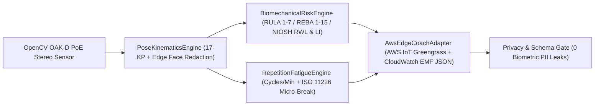

# System Architecture — ErgoSight CV

## 1. Edge-to-Cloud Pipeline

---

## 2. Core Modules

| Module | File Path | Deterministic Invariant |
| :--- | :--- | :--- |
| **PoseKinematicsEngine** | `src/lib/pose/pose-kinematics-engine.ts` | Clamped vector dot-product angles (`[0°, 180°]`), 17-keypoint anatomical skeleton, and `0` HUD bounding-box overlaps on the `880x420` SVG canvas (`verifyZeroHudOverlap`). |
| **BiomechanicalRiskEngine** | `src/lib/ergonomics/biomechanical-risk-engine.ts` | Validated RULA `[1, 7]`, REBA `[1, 15]`, L5/S1 lumbar disc compression (Newtons), and Revised NIOSH Lifting Equation (`RWL` & `LI`) across 4 industrial presets (`verifyBiomechanicalBounds`). |
| **RepetitionFatigueEngine** | `src/lib/fatigue/repetition-fatigue-engine.ts` | Strictly monotonic 6-checkpoint shift fatigue accumulation curve (`verifyMonotonicFatigueCurve`) and micro-break scheduling. |
| **AwsEdgeCoachAdapter** | `src/lib/aws/aws-edge-coach-adapter.ts` | Validated AWS CloudWatch EMF telemetry JSON with `BiometricPiiRedacted: true` and `0` cranial/facial PII leaks (`verifyPrivacyCompliantTelemetry`), plus `4.5s` `AbortController` circuit breaker. |
